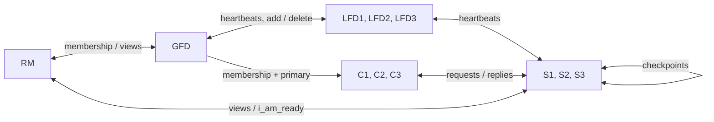
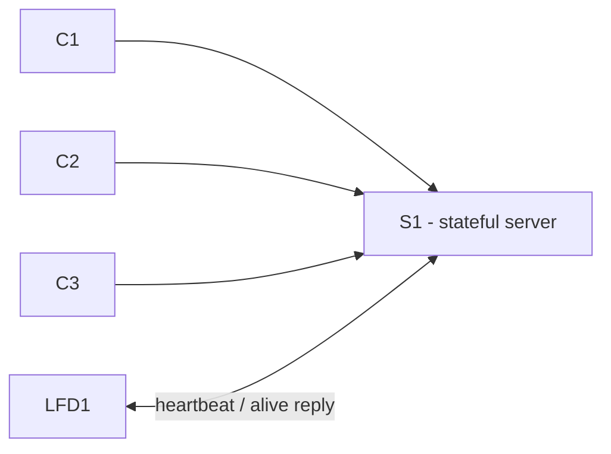

# 18-749 Reliable Distributed Systems - Python

## Introduction

This project implements a simplified fault-tolerant distributed application in **Python**. The full course project gradually adds replication, fault detection, membership management, checkpointing, and recovery so that the application can continue running when a server replica fails.

For Milestone 1, we build only one stateful server, three independent clients, and one Local Fault Detector (LFD). The simplest valid application is a shared counter:

```text
my_state = 0
C1 sends ADD 1
S1 updates my_state to 1
S1 replies with STATE 1
```

The project is demonstrated through terminal output. No website, database, Docker configuration, or cloud deployment is required for Milestone 1.

## Status

| Milestone | Status |
| --- | --- |
| 1: client-server with LFD | Implemented |
| 2: active replication with GFD | Implemented |
| 3: passive replication with checkpoints | Implemented |
| 4: RM, manual recovery, primary re-election | Implemented; see [Milestone 4](#milestone-4) |
| 5: automatic recovery | Not started |

See [AGENT_CONTEXT.md](AGENT_CONTEXT.md) for Milestone 1 design decisions and the bugs found and fixed during testing.

## Milestone 4

Milestone 4 adds the Replication Manager (RM) and lets a failed replica rejoin without stopping the system. It runs in two configurations: active and passive replication.

### Architecture



| Machine | Processes |
| --- | --- |
| Sacred machine | RM, GFD, C1, C2, C3 |
| Replica machine 1 | S1, LFD1 |
| Replica machine 2 | S2, LFD2 |
| Replica machine 3 | S3, LFD3 |

### How recovery works

1. An LFD detects a crash and tells the GFD, which reports the new membership to the RM.
2. The RM publishes a numbered **view**: the members, which ones are ready, and the primary. Replicas get it directly from the RM. Clients get it from the GFD.
3. A relaunched replica starts with `i_am_ready = 0`, registers with its LFD and the RM, and rejoins the membership.
4. A ready replica sends it a checkpoint over the secondary channel. In passive mode that is the primary. In active mode it is the first ready replica in the view.
5. The replica installs the checkpoint, sets `i_am_ready = 1`, and tells the RM.

A replica joining an empty group is the first of its kind and is ready immediately. Every later replica goes through the steps above, including S2 and S3 at first launch.

**Active replication:** while not ready, a replica logs each request and updates `high_watermark_request_num[]`, but does not process or reply. After installing a checkpoint it replays only the logged requests the checkpoint does not include. Clients wait at most 0.3 seconds for extra replies after the first one, so a silent replica does not hold them up.

**Passive replication:** when the primary leaves, the RM elects the earliest-joined ready replica. A relaunched replica always returns as a backup. The new primary's state may be up to one checkpoint old, so each client resends the requests that no checkpoint is known to cover. The primary's replies tell clients which requests they can forget.

**Duplicate detection:** every checkpoint carries each client's highest applied `request_num`. A replica that receives a request at or below that number does not apply it again, but still replies. This makes it safe for clients to retry and resend.

**Missed requests:** a client can connect to a recovering replica just after that replica's checkpoint, having already sent a request only to the others. The replica notices the skipped `request_num`, returns to `i_am_ready = 0`, and gets a new checkpoint.

### Run the demo on separate machines

You need four devices on the same network, all on the same branch of this repo, with Python 3 and tmux installed. So far this has only been tested on one laptop, using its network address and simulated device failures. It has not yet run on real separate devices.

**1. On the sacred machine,** start the RM and GFD. Use `active` or `passive`. The script prints the IP address the other devices need.

```text
./run_device_M4.sh sacred active
```

**2. On each replica machine,** start its LFD, using the number for that machine and the sacred machine's IP:

```text
./run_device_M4.sh replica 1 active <SACRED_IP>
./run_device_M4.sh replica 2 active <SACRED_IP>
./run_device_M4.sh replica 3 active <SACRED_IP>
```

**3. Launch the replicas.** Their commands are already typed into their panes. Press `Enter` in the S1 pane, then S2, then S3. In passive mode, the first one started becomes the primary, so no replica is hard-coded as primary.

**4. Launch the clients.** On the sacred machine, press `Enter` in the C1, C2, and C3 panes, one at a time.

To inject a fault, press `Ctrl-C` in a replica's pane. To recover it, press `Up` then `Enter` in the same pane. To stop a device, run the `tmux kill-session` command that its script prints.

The script passes `--state-transfer-delay 3` to each replica, which keeps it not ready for 3 seconds after launch. Without this, state transfer finishes too quickly to see the logging that rubric step 21 asks for. Set `STATE_TRANSFER_DELAY=0` to turn it off.

To try this on one laptop, run all four commands in separate terminals on that laptop, using its network IP as `<SACRED_IP>`. The sacred machine's script prints that address.

#### Without tmux

Run these from the repo root, each in its own terminal. They also work on Windows, using `python` if `python3` is not available.

```text
# Sacred machine
python3 src/replication_manager.py --port 6100 --replication-mode <MODE>
python3 src/global_fault_detector.py --port 6000 --rm-host 127.0.0.1 --rm-port 6100

# Replica machine N (1, 2, or 3)
python3 src/local_fault_detector.py --lfd-id LFDN --replica-id SN --server-host 127.0.0.1 --server-port 500N --heartbeat-freq 1 --gfd-host <SACRED_IP> --gfd-port 6000
python3 src/server_replica.py --replica-id SN --port 500N --replication-mode <MODE> --checkpoint-freq 2 --rm-host <SACRED_IP> --rm-port 6100 --state-transfer-delay 3

# Sacred machine, for each client K (1, 2, or 3), after the replicas are up
python3 src/client.py --client-id CK --gfd-host 127.0.0.1 --gfd-port 6000 --replication-mode <MODE> --add-amount K
```

#### If devices cannot connect

| Symptom | Likely cause and fix |
| --- | --- |
| LFD repeats `Could not connect to GFD` | Check the IP address, and that the sacred machine's script is running. From the replica machine, test with `nc -vz <SACRED_IP> 6000`. |
| `nc` times out, but both devices are online | The network may block device-to-device traffic, which is common on campus Wi-Fi. Use a phone hotspot or Tailscale. |
| `nc` is refused, or macOS shows a firewall prompt | Allow incoming connections for Python in System Settings > Network > Firewall. |
| Clients cannot connect to a replica | Read the LFD's line `Other machines will reach S1 at ...`. If the address is wrong, for example on a device with a VPN, pass the right one with `--replica-public-host`. |
| `Port ... is already in use` | An older run is still going. Stop it with the `tmux kill-session` command for that session. |

#### When a whole device fails

The guide treats an LFD failure as the failure of its whole machine. If an LFD's connection closes, or the GFD hears nothing from it for `--lfd-timeout` seconds (5 by default), the GFD removes that machine's replica. This timeout must be longer than `--heartbeat-freq`.

When the device returns, its LFD reconnects and registers the replica again. Because the replica may have missed requests, it sets `i_am_ready = 0` and catches up from a checkpoint before serving. An old primary comes back as a backup.

### What to look for

| Rubric item | Where to see it |
| --- | --- |
| `RM: 0 members`, `RM: 3 members: S1, S2, S3` | RM pane |
| `GFD: 2 members: S1, S3` after a fault | GFD pane |
| `FAILED/TIMED OUT` and `delete replica S2` | LFD2 pane |
| `Discarded duplicate reply from S3` | Client panes, active mode |
| `i_am_ready = 0: logged <C1, S2, ...>` | Relaunched replica, active mode |
| `Received checkpoint`, then `i_am_ready = 1 after checkpoint` | Relaunched replica |
| `Sending checkpoint #N` with `my_state` and `checkpoint_num` | Primary, passive mode |
| `RM: primary S1 is gone; elected new primary S2.` | RM pane, passive mode |
| `Promoted to PRIMARY` | New primary, passive mode |
| `Failover from S1 to S2: resending ...` | Client panes, passive mode |

### Limitations

- **The RM, GFD, and LFDs are single points of failure**, as the project guide allows. They do not recover if killed.
- **Replicas in active mode can process different clients' requests in a different order.** Nothing enforces a total order across clients. `my_state` still converges because `ADD` is commutative, but two replicas' replies to the same request can show different values. A non-commutative operation would need real total ordering.
- **Restarting a client without restarting the servers misbehaves.** The new process starts again at `request_num` 1, so its requests count as duplicates until it passes its old number. Restart the whole demo instead.
- **If every replica fails, the state is lost.** The next replica starts as the first of its kind with `my_state = 0`.
- **A crash detected falsely is not handled.** A slow primary that the LFD reports as failed would still believe it is primary until it receives the next view.
- **Automatic relaunch is Milestone 5.** Failed replicas must be relaunched by hand.

## Milestone 1

### Goals

1. Run a client-server application.
2. Demonstrate that LFD1 detects when S1 crashes.
3. Support a configurable heartbeat frequency at LFD1.

### Architecture



| Location | Processes |
| --- | --- |
| Sacred/client machine | C1, C2, C3 |
| Non-sacred/server machine | S1 and LFD1 |

`C1`, `C2`, and `C3` can use the same Python file, but they run as separate processes with different client IDs. LFD1 runs on the same machine as S1.

### Required behavior

- [x] S1 listens for TCP connections.
- [x] C1, C2, and C3 each send requests to S1.
- [x] S1 changes `my_state` when it receives a client request.
- [x] Each client prints sent requests and received replies.
- [x] S1 prints received requests, sent replies, and `my_state` before processing and before replying.
- [x] LFD1 sends a heartbeat to S1 repeatedly.
- [x] LFD1 maintains and prints `heartbeat_count`.
- [x] `heartbeat_freq` is configurable through a command-line argument and is not hard-coded.
- [x] S1 prints heartbeat receipt and its alive reply.
- [x] After S1 is killed with `Ctrl-C`, LFD1 prints a failed-heartbeat/timeout message.
- [x] Restart the system using a different heartbeat frequency and repeat the demonstration.

Clients support both modes: `--mode auto` (default, sends on a timer in a loop) and `--mode manual` (prompts for each request from the keyboard).

### Message and logging conventions

Every console message should start with a local timestamp. Each client request needs a unique request number and client ID; each reply returns those same identifiers.

```text
<C1, S1, 1, request>
<C1, S1, 1, reply>
```

Suggested line-based message protocol:

```text
REQUEST|C1|S1|1|ADD|1
REPLY|C1|S1|1|STATE|1
HEARTBEAT|LFD1|S1|1
ALIVE|S1|LFD1|1
```

The exact message format is a team choice; the course guide does not mandate this syntax.

## Python setup

Python's standard library is sufficient for Milestone 1. No third-party packages are required.

```text
socket      - TCP connections
argparse    - command-line arguments
time        - heartbeat scheduling
datetime    - timestamped logs
```

Actual project structure:

```text
project/
  src/
    server_replica.py
    client.py
    local_fault_detector.py
    protocol.py
    net_utils.py
    log_utils.py
    global_fault_detector.py
    replication_manager.py
  run_demo.sh
  run_device_M4.sh
  README.md
  AGENT_CONTEXT.md
```

| File | Responsibility |
| --- | --- |
| `server_replica.py` | Runs S1, owns `my_state`, handles requests, replies, and heartbeat responses. |
| `client.py` | Runs as C1, C2, or C3 depending on command-line arguments. Supports `--mode auto`/`manual`. |
| `local_fault_detector.py` | Runs LFD1, sends periodic heartbeats, and reports timeout failures. |
| `protocol.py` | Creates and parses request, reply, heartbeat, and alive messages. |
| `net_utils.py` | Reusable TCP server/client socket helpers, shared by every process. |
| `log_utils.py` | Provides consistent timestamped, color-coded terminal logging. |
| `global_fault_detector.py` | Runs the GFD: tracks membership and informs the RM and clients. |
| `replication_manager.py` | Runs the RM: decides which replicas are ready and which is primary. |
| `run_demo.sh` | Launches the Milestone 1 demo in one tmux window (single laptop). |
| `run_device_M4.sh` | Starts one device's share of the Milestone 4 system (separate devices). |

### Development mode: one laptop

Fastest option — run the tmux demo script from the repo root (opens all 5 processes in one window):

```text
./run_demo.sh          # heartbeat_freq defaults to 1 second
./run_demo.sh 0.5      # re-demo with a different heartbeat_freq
```

Or run manually in five terminals:

```text
Terminal 1: python3 src/server_replica.py --replica-id S1 --host 0.0.0.0 --port 5000
Terminal 2: python3 src/local_fault_detector.py --lfd-id LFD1 --replica-id S1 --server-host localhost --server-port 5000 --heartbeat-freq 1
Terminal 3: python3 src/client.py --client-id C1 --server-host localhost --server-port 5000
Terminal 4: python3 src/client.py --client-id C2 --server-host localhost --server-port 5000
Terminal 5: python3 src/client.py --client-id C3 --server-host localhost --server-port 5000
```

`--heartbeat-freq` is in seconds and required (no hard-coded default). For local testing, all processes connect to `localhost:5000`.

### Demo mode: two machines

`localhost` means the current machine only.

```text
Server machine:
  S1 listens on 0.0.0.0:5000
  LFD1 connects to localhost:5000

Client machine:
  C1, C2, C3 connect to <server-machine-IP>:5000
```

GitHub shares the source code between teammates. It does not connect the processes; clients connect through S1's hostname/IP address and TCP port.

## Key assumptions and constraints

- The server is deterministic: the same state plus the same request produces the same next state and reply.
- Keep S1 single-threaded for this project stage unless the team has a deliberate deterministic design.
- A heartbeat timeout is a practical failure suspicion: no reply can mean S1 is slow or crashed. In the Milestone 1 demo, S1 is intentionally killed to show the timeout.
- The project focuses on a single server crash and client-server message loss. Milestone 1 directly demonstrates the crash case.
- The final project has S1, S2, and S3, but Milestone 1 uses only S1.
- RM, GFD, replication, checkpoints, duplicate detection, and recovery are not required for Milestone 1.
- Console output is the required demo interface.


